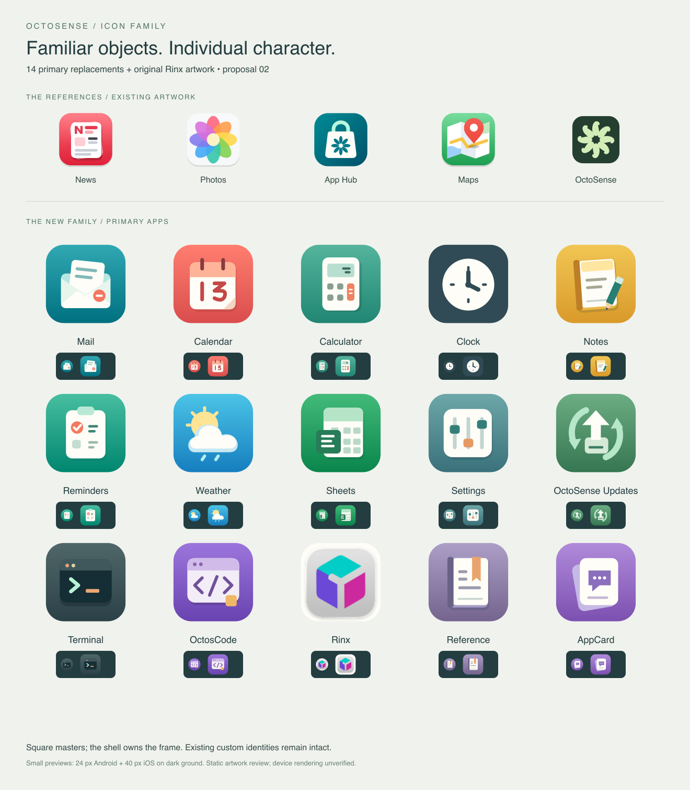
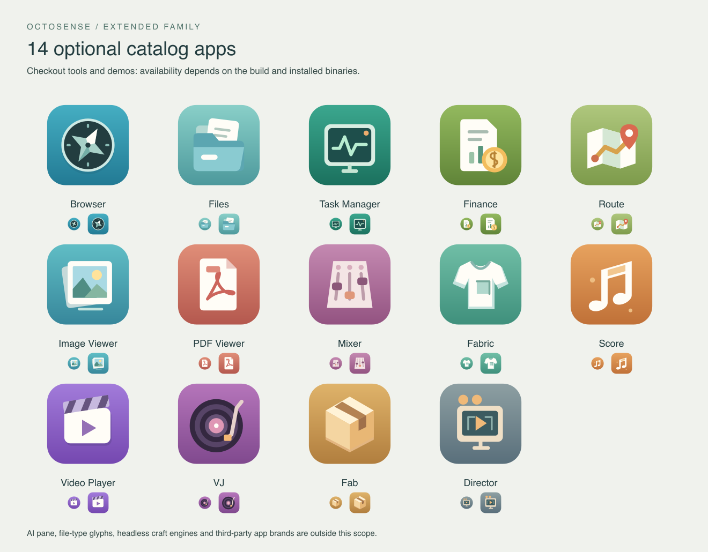

# OctoSense 图标家族

[English](README.md) | 简体中文

**已批准的图标家族，2026-10-15。** 本目录提供 28 个原创 SVG 替换图标、Rinx 原始 PNG，以及从 News、
Photos、App Hub、Maps 和 OctoSense 现有图形中提炼的图标设计规范。
已批准的图标现已接入共享 Shell 图标目录及 Mail/Calendar 系统应用包。
从此源码构建即可生效；修改源码不会更新已经安装的发行版本。



## 需要多少图标？

**14 个产品应用需要新图标**，其中包含通过功能开关启用的原生应用；**Rinx 使用原始图标**。
**另有 14 个应用**出现在可选的源码目录中，合计 **28 个新图标与一个恢复的原图**。
这是跨两个产品去重后的应用身份数量，并不意味着每个构建都会显示全部应用。

盘点范围包括 `desktop/system-apps.json` 的 10 个包、
`phone/system-apps.json` 的 8 个包（两者共 11 个不同应用包）、
`native-apps.json` 中启用或可通过功能开关启用的原生应用、Home 的 Settings、
Shell 的 Assistant，以及两个 `config/apps.json` 目录。
源码目录中的应用可能尚未构建，因此不一定在本机可见。

修改之前，六个产品应用没有匹配的图标，都回退到同一个 `app.svg`：
**Settings、Updates、Rinx、OctosCode、Reference、AppCard**。
其余替换对象使用 Makepad 的既有插画，有各自的应用含义，但尚无本地 OctoSense 视觉身份。

Rinx 自己的仓库已有原始图标。Shell 现已恢复原图，不再重新设计。
1024 像素 PNG 从 `native-apps.json` 固定版本的 `resources/icon_1024.png`
逐字节复制，详见[来源与校验和](references/rinx/provenance.json)。上游许可和署名文件一并保留。

| 产品应用 | 当前图标 | 提议的视觉身份 |
| --- | --- | --- |
| Mail | Makepad 信封 | 象牙白折叠信封、薄荷色信纸、珊瑚色封印 |
| Calendar | Makepad 日历 | 带实体装订环的珊瑚色翻页日历 |
| Calculator | Makepad 计算器 | 象牙白机身、鼠尾草色显示屏、珊瑚色等号键 |
| Clock | Makepad 表盘 | 双色象牙白表盘与深色指针；移除表圈、底脚和秒针 |
| Notes | Makepad 便笺 | 口袋笔记本与薄荷色铅笔 |
| Reminders | Makepad 待办列表 | 象牙白夹板与珊瑚色完成标记 |
| Weather | Makepad 晴云 | 奶油黄太阳、象牙白云朵、两道雨线 |
| Sheets | Makepad 工作簿 | 象牙白工作簿与绿色公式标签，所有单元格统一颜色 |
| Settings | 共享默认应用图 | 带三枚实体滑块的象牙白控制面板 |
| OctoSense Updates | 共享默认应用图 | 薄荷色循环箭头之间的向上安装箭头 |
| Terminal | Makepad 提示符 | 深色命令窗口、薄荷色提示符、杏色光标 |
| OctosCode | 共享默认应用图 | 象牙白代码窗口、紫色括号、琥珀色标签 |
| Rinx | 共享默认应用图 | 恢复 Rinx 原始立方体图标 |
| Reference | 共享默认应用图 | 带杏色书签的象牙白参考书 |
| AppCard | 共享默认应用图 | 叠放的象牙白卡片与内嵌聊天面板 |

Reference、Sheets 和 AppCard 的可用性取决于功能配置；Terminal 仅用于桌面端。
Settings 属于 Home。同一个应用在两个产品出现时可以共用图形。

**14 个可选目录应用**为 Browser、Files、Task Manager、Finance、Route、
Image Viewer、PDF Viewer、Mixer、Fabric、Score、Video Player、VJ、Fab、
Director（`studio`）。Task 的原生模块在两个产品中均关闭，但源码目录仍保留其进程入口。



## 保留现有身份

| 身份 | 当前来源 | 处理方式 |
| --- | --- | --- |
| News | `crates/shell/resources/icons/apps/<style>/news.svg` | 作为参考，保留 |
| Photos | 固定版本 Makepad 的 `widgets/themes/<style>/icons/photos.svg` | 用户明确指定的参考，即使来自上游也保留 |
| App Hub | 链接的 App Hub `APP_ICON_SVG`；本地回退为 `crates/shell/resources/icons/apps/apphub.svg` | 作为参考，保留 |
| Maps | `crates/shell/resources/icons/apps/<style>/maps.svg` | 作为参考，保留 |
| OctoSense | `desktop/packaging/icons/icon.svg` 与 `mark.svg` | 保留主品牌 |
| Assistant | `crates/shell/resources/icons/apps/assistant.svg` | 保留现有品牌对话气泡 |
| Rinx | 固定版本 Rinx 的 `resources/icon_1024.png` | 恢复原始立方体图形，不重绘 |
| Camera | `apps/camera/bundle/icon.png` | 保留现有自定义应用包图标 |
| AI providers | `apps/ai-providers/bundle/icon.png` | 保留现有自定义应用包图标 |
| YouTube | `apps/youtube/bundle/icon.svg` | 保留外部品牌身份 |
| Writer | `apps/writer/bundle/icon.svg` | 保留现有纸张与铅笔 |
| Quick Deck | `apps/quickdeck/bundle/icon.svg` | 保留现有幻灯片叠层 |
| PDF Tools | `apps/pdftools/bundle/icon.svg` | 保留现有文档叠层 |

Wasm Lab 已有自己的 SVG，且不在两个发布目录中。`aichat` 仅供 AI 面板使用。
无界面的 craft 服务、文件类型图标、用户创建的 Studio 应用和已安装第三方应用不计入范围。
PDF Viewer 与 PDF Tools、Route 与 Maps、Image Viewer 与 Photos 是不同应用，
因此图标也有意保持可辨识的差异。

## 设计规范

推荐延续参考图标中**彩色底面上的小型物件插画**。
单色符号会失去现有图形的材质感；写实 3D 会引入不同的细节密度。
原创 SVG 便于编辑，也能沿用当前的矢量资源流程。

**形态。** 每个图标有一个主物件，必要时增加一个辅助线索。
轮廓清晰、边缘柔和，叠放关系明确。使用错位纸张和折角，而不是堆积细碎装饰。
OctoSense 标记继续用于 App Hub、Assistant 等既有品牌表面，不应盖在每个应用上。

**材质。** 暖象牙白 `#fffdf7` 作为共同的浅色材质，深墨色 `#233d40` 用于深色物件。
薄荷色辅助信纸和卡片，杏色标记控件或书签，珊瑚色标记完成动作或小面积强调。
深度限制为两到三层，通过轻微的局部接触阴影表达。不使用外部投影、玻璃高光、
照片纹理或镜头效果。

**色彩。** 每个应用使用易辨识的底色和克制的垂直渐变。
青色用于沟通与导航，珊瑚色用于日期与文档，琥珀色用于笔记和音乐，
绿色用于结构化工作与维护，紫色用于代码和对话卡片。
颜色辅助物件，轮廓本身也必须可辨识。各应用的精确色值见 [inventory.json](inventory.json)。

**几何。** 使用 64 点正方形画布，背景满版。
整个前景限制在中心 66% 内，即两个轴上的约 10.88–53.12。
主要线条在视觉缩放前约为 2–3.5 点。必要的数字由路径绘制，不依赖字体。
24 像素下，局部点缀不能抢占主体。按 64、40、24 像素检查，覆盖浅色和深色底面，
以及 Android、macOS、iOS 三种外框。

**外框。** 源资源使用正方形背景，不预制圆角、圆形裁切或外部投影。
形状由 Shell 的共享外框策略决定；OctoSense 使用 macOS 几何。
评审图采用当前几何的静态近似，并非 Shell 截图。
保留的 Rinx 原始 PNG 属于旧资源例外：原有处理完整保留，预览应用所选外框，但不编辑 PNG。
参见[现有启动器图标规则](../../../apps/README.zh-CN.md#启动器图标规范)。

## 为新应用创作图标

为新的 OctoSense 应用创作图案时采用以下格式。共用家族是一套视觉语言，不是供新应用直接复用的通用图标集合。

1. 选取一个代表应用实际用途的主体物件，形成独特轮廓，最多加入一个辅助提示。保留有权使用的既有应用品牌；不要复制其他应用图标，也不要给无关应用加上 OctoSense 或 App Hub 标志。
2. 维护一份可编辑 SVG 原稿，使用 `viewBox="0 0 64 64"` 和正方形数值尺寸。以满幅彩色背景和暖象牙白物件（`#fffdf7`）为基础，用墨色（`#233d40`）形成对比，薄荷色、杏色或珊瑚色作克制的点缀。使用大块形状、圆润物件边缘和两三层重叠关系。所有前景细节均位于两轴 10.88–53.12 之间。背景色可因应用而异；物件不依赖颜色也应可辨识。
3. 使用自包含的路径、矩形和圆形，显式指定颜色，文字转换为路径。纵深效果限制在物件本身。导出正方形图案，不预制平台圆角、蒙版或外部投影。原图是位图时使用正方形 PNG，并保留设计所需的透明度；遵循 App Hub 的尺寸及准入限制。
4. 在深浅背景上，以 64、40、24 像素检查，与家族图标并排比较，并预览 Android、macOS 和 iOS 外框。声称原生验收通过前，应检查真实目标 Shell 的渲染。原稿、来源和评审图放在发布包之外，运行时需要的除外。
5. 商店应用必须用自己的身份图案替换模板图标，将图案作为 `bundle/assets/icon.svg`（或 PNG）随包发布，并在 `listing.json` 中声明对应的包内相对路径。Shell 会自动通过 `AppIconDraw` 绘制。不要把商店应用加进内置覆盖层，也不要修改 Makepad 图标。内置家族的新成员则使用本地生成器、明确的注册清单及 Omarchy 线稿，并运行现有资源与渲染检查。

[App Hub 图标指南](https://github.com/OctoSense-org/OctoSense-App-Hub/blob/main/docs/ICONS.zh-CN.md)负责打包与准入限制；App Flow 的模板指引及发布流程把这些创作规则带进每个新应用。准入检查通过只证明文件有效，不证明视觉质量或符合本家族风格。

## 接入与验证

**浏览器于 2026-10-21 更新：** 已批准的替换方案为 C5 夜色罗盘，使用墨色表盘、薄荷色边框、四角罗盘和象牙白东北方向尖角。

共享 Shell 在 `crates/shell/resources/icons/apps/family/` 中嵌入了 28 个批准的
SVG 源图及其 Omarchy 线稿版本。图标目录替换对应的上游条目，并补充 Settings、
Updates、OctosCode、Reference 和 AppCard。Rinx 原始 PNG 单独嵌入，
使用与应用包图形相同的平台图像遮罩绘制。已安装的 `hub:` 应用仍保留自己的图标。

Mail 和 Calendar 的系统应用包也带有批准的 `icon.svg`，由 App Hub 自动打包。
对于明确归本地图标家族所有的内置身份，所有样式均优先使用家族目录版本。
其他已有自定义应用包及已安装的 `hub:` 应用保留自己的图标。
启动器、Dock、Home、分组预览和应用徽标沿用共享 `AppIconDraw` 路径。
Omarchy 目录使用批准物件的线稿版本，避免单色着色时丢失内部细节。
Windows 2000 使用无彩色底块的自由轮廓画布，保留该样式中已有的 News 和 Maps 图形。

### 便于合并 Makepad 更新

本功能不修改 Makepad 源码目录、主题图标文件或运行时补丁。`icon_assets` 先加载上游目录，再调用一次 `icon_family::apply`。本地模块管理明确的 28 个替换 ID，按 ID 合并并补充缺失的本地身份，不复制或冻结整个上游目录。

Makepad 修改已有覆盖项时，OctoSense 保留已批准的替换图标。Makepad 新增未覆盖的身份或修改未覆盖的图标时，原样采用上游图案。移除覆盖项属于明确的本地策略调整。Rinx 继续使用独立的原始 PNG，Photos 继续继承上游图案；News、Maps、App Hub 和 Assistant 的已有自定义图标保留在原来的覆盖层。

实际策略为：原生 Android 应用图标保留现有系统绘制路径；已安装的 `hub:` 应用使用自身图标；明确的内置替换项使用本地图标家族；其他系统应用包可提供自身图标；其余身份使用 Makepad 目录及通用后备图标。平台外形仍由 `AppIconDraw` 和共享外框策略控制。

今后更新 Makepad 时，按正常流程更新版本固定点及预备源码，再运行下文的家族同步检查、Shell 测试和隐藏窗口预览，无需挑选图标提交或修改 `.sources/makepad`。回归测试模拟上游修改 Browser 及新增身份，检查重复覆盖不会产生重复条目，并使用 ID 并集检查目录，不依赖固定的上游图标数量。

- [本次修改](revised-icons.png)：简化的 Clock、单元格同色的 Sheets 与 Rinx 原始图标。
- [主要图标家族](family-primary.png)：14 个新图标与 Rinx 原图，以及五个参考。
- [可选图标家族](family-optional.png)：14 个额外目录工具。
- [前后对比](before-after.png)：主要应用的当前与提议图标。
- [外框与尺寸检查](platform-review.png)：29 个图标，三种尺寸、三种外框、两种底面。
- [资源](assets/)：28 个可编辑、未加平台外框的 SVG 源图与 Rinx 原始 PNG。
- [清单](inventory.json)：应用 ID、范围、概念、配色与来源路径。
- [验证记录](validation.json)：数量、实测前景范围与资源哈希。
- [接入验证记录](implementation-validation.json)：源码哈希、构建及测试结果、GPU 检查。
- [实际 GPU 截图](evidence/)：七种 Shell 样式中的图标家族及保留的自定义图形。

完成 setup 后，在仓库根目录重新生成：

```sh
python3 tools/build_icon_family.py
python3 tools/build_icon_family.py --install
python3 tools/build_icon_family.py --check
```

以上命令均已运行。生成评审图需要 `rsvg-convert` 和 Pillow；
`--check` 只读检查全部 63 个发布资源是否与批准的源图一致。
它检查与当前原生及源码目录的覆盖关系、28 个不同 SVG 前景、XML 解析、
新 SVG 的满版正方形背景与实测安全区、Clock 的双色配色、Sheets 单元格的统一颜色，
以及 Rinx 原始 PNG 与来源记录的校验和，所有检查均通过。
主要图、可选图、外框与尺寸检查图、前后对比图均已进行视觉检查。

实际接入通过了 **1,280 个共享 Shell 单元测试**、桌面默认功能和 `mobile-apps`
构建检查、Home 的 `mobile-apps` 构建检查，以及两个 Shell 的依赖图检查。
已有品牌资源测试（5 个）与个人路径回归检查（1 个）也均通过。

隐藏窗口中的生产渲染器通过了 **238 个图标家族像素检查**与 **34 个既有 PNG/SVG
形状、颜色及透明度检查**。截图覆盖 29 个应用身份、七种样式、64 和 24 逻辑像素、
深浅底面、完整与半透明显示。每种带外框样式均检查了 C5 的深色表盘、象牙白东北尖角和薄荷色侧角。自由轮廓样式有专门检查，防止 Mail/Calendar 的应用包优先级
绕过家族版本。四页家族截图均已进行视觉检查。以上属于单元测试与 GPU 固定场景验证，
不声称测试了真实模型调用或业务效果。

重复 GPU 检查时，先从 `phone/` 构建：

```sh
cargo build --locked --features mobile-apps -p octosense-shell --example icon_shapes
```

然后从仓库根目录运行：

```sh
python3 tools/check_icon_family_preview.py --capture
```

两个命令均已运行。截图工具为 Home、Rinx 创建分开的临时目录，隐藏所有窗口，
使用回环控制端口，并通过 `/quit` 关闭每个预览，同时处理 Retina 后备像素比例。

**设备：未验证。** 本次未指定测试设备。在 macOS 进程中检查平台样式，
与 Android、iOS、Windows、Linux 原生设备验收及实际发布分别记录。
