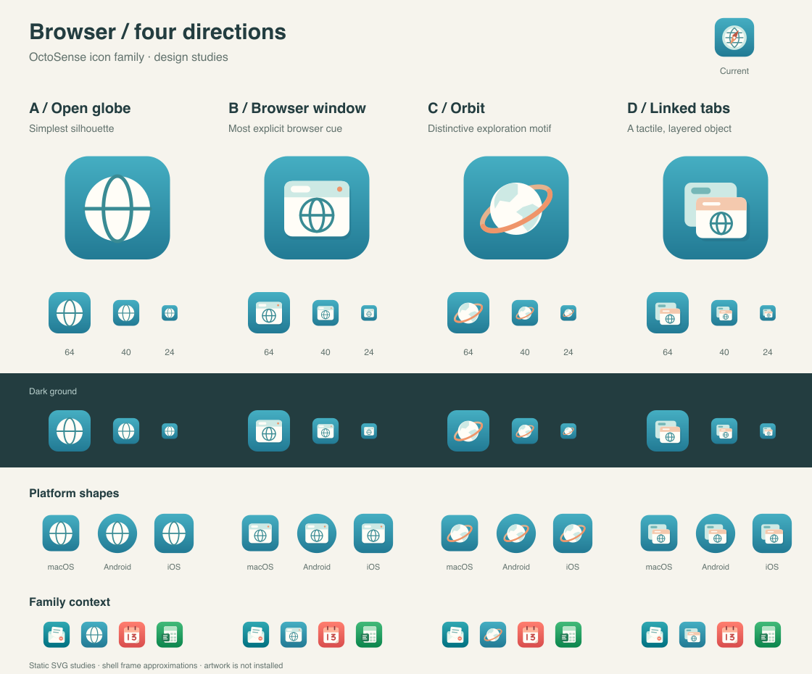

# Browser icon alternatives

English | [简体中文](README.zh-CN.md)

Four design studies extend the approved OctoSense icon family. These are review
assets; the installed Browser icon and the family generator remain unchanged.

See also [the second set: Compass, World + pointer, Sail and Search lens](set-2/README.md).

**Selected direction: Compass.** Continue with [four Compass refinements](compass-variations/README.md).



| Option | Direction | Tradeoff |
| --- | --- | --- |
| [A — Open globe](a-open-globe.svg) | Ivory globe with two broad geographic lines | Simplest and strongest at small sizes; a familiar web symbol |
| [B — Browser window](b-browser-window.svg) | Tactile ivory window, mint tab bar and outlined globe | Recommended for clear browser recognition and a close fit with the illustrated family |
| [C — Orbit](c-orbit.svg) | Ivory world with mint land and an apricot orbit | Most distinctive silhouette; can also suggest space or exploration |
| [D — Linked tabs](d-linked-tabs.svg) | Two overlapping windows with a globe on the front tab | Emphasizes browsing between pages; smaller internal details |

All four use the approved Browser teal gradient, warm ivory and restrained
mint/apricot accents. Editable masters have square, full-bleed backgrounds
without baked platform corners or outer shadows. Foreground pixels fit inside
the central 66% safe area.

The comparison includes the currently implemented icon, 64/40/24 px previews,
light and dark grounds, approximate macOS/Android/iOS frames, and Mail,
Calendar and Sheets as family context. These are static librsvg renders;
production rendering and device behavior are **unverified** for these studies.

To rebuild from the repository root:

```sh
python3 docs/design/icon-family/browser-alternatives/build.py
```

This command was run. It requires librsvg's `rsvg-convert` and Pillow, checks
SVG parsing and raster foreground bounds, and writes the four SVG masters and
the SVG/PNG comparison. The generated comparison was visually inspected.
