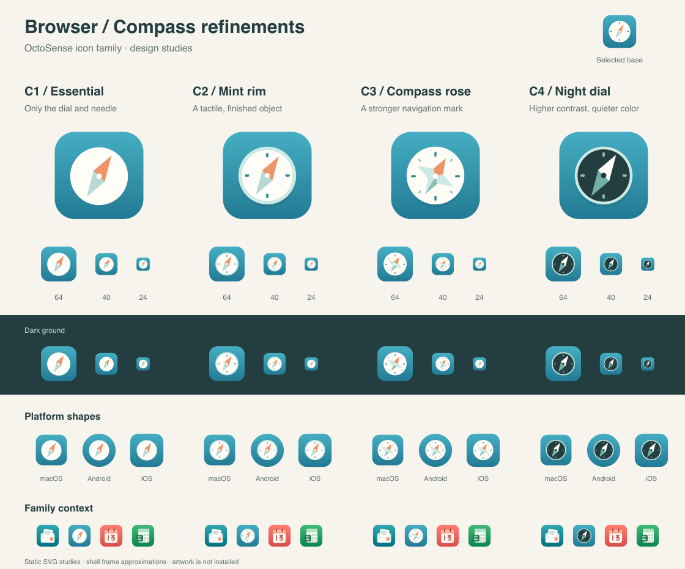
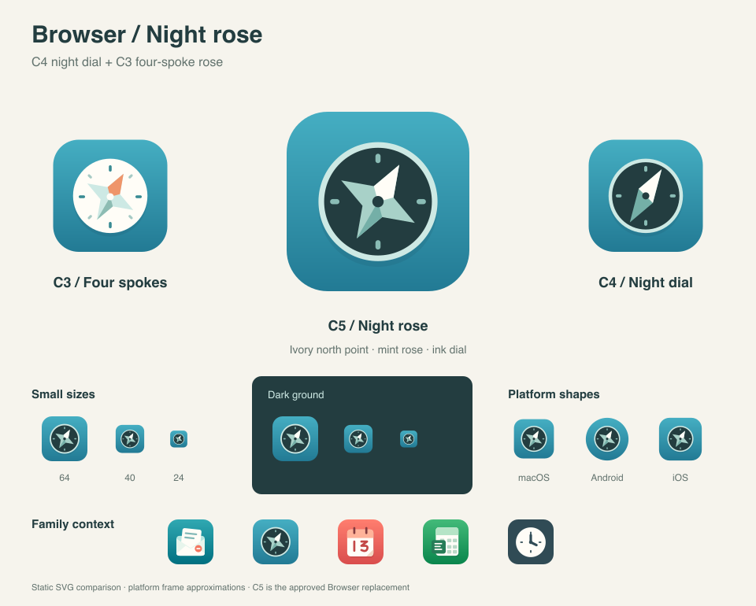

# 浏览器 — 指南针图标变体

[English](README.md) | 简体中文

**已选方向：指南针（第二组的 E）。** 用户已选择指南针作为主要设计方向。**C5 夜色罗盘已于 2026-10-21 获得批准**，现为整套家族中的浏览器替换图标。C1–C4 保留为此前设计方案。



## C5 — 夜色罗盘

按要求组合 **C4 的墨色表盘、薄荷色边框和四个刻度**，以及 **C3 的四角罗盘**。东北方向采用象牙白，其余尖角采用不同深浅的薄荷色，中心轴为墨色。保留 C3 的四角几何形状和 30 度旋转，并对齐 C4 的表盘中心。已批准的图形现由 `tools/build_icon_family.py` 生成正式 Browser 图案及 Omarchy 线稿。



[可编辑的 C5 原稿](c5-night-rose.svg)。在仓库根目录重新生成：

```sh
python3 docs/design/icon-family/browser-alternatives/compass-variations/night-rose.py
```

此命令已运行，XML 解析和前景像素安全区域检查通过。已目视检查 64/40/24 像素、深浅背景和近似平台外框静态预览。本静态预览的生产渲染及设备表现均**未经验证**；最新生产验证记录见[家族指南](../../README.zh-CN.md)。

## 此前的变体

| 变体 | 表现方式 | 取舍 |
| --- | --- | --- |
| [C1 — 极简](c1-essential.svg) | 象牙白表盘与较宽的双色指针，无刻度 | 轮廓最简洁，细节最少 |
| [C2 — 薄荷色边框](c2-mint-rim.svg) | 薄荷色外壳、内嵌象牙白表盘、四个刻度及杏色/薄荷色指针 | 推荐：具有实体质感，与已批准图标家族协调 |
| [C3 — 罗盘玫瑰](c3-compass-rose.svg) | 四角罗盘配八个简洁方向刻度 | 导航特征鲜明，内部细节较多 |
| [C4 — 深色表盘](c4-night-dial.svg) | 墨色表盘、薄荷色外壳及象牙白/薄荷色指针 | 配色克制，深色形象独特 |

四个变体均保留浏览器青色渐变与原指南针的东北朝向。可编辑 SVG 原稿采用正方形满幅背景，不预置平台圆角或外部阴影；前景像素位于中央 66% 安全区域内。

右上角显示已选基础方案。预览包含 64/40/24 像素、深浅背景、macOS/Android/iOS 近似外框，以及邮件、日历和表格图标的家族搭配。这些是 librsvg 静态渲染；这些变体的生产渲染及设备表现均**未经验证**。

在仓库根目录重新生成：

```sh
python3 docs/design/icon-family/browser-alternatives/compass-variations/build.py
```

此命令已运行。脚本复用此前的预览生成器，需要 `rsvg-convert` 和 Pillow，检查 XML 解析及前景像素边界，并生成四个 SVG 原稿与 SVG/PNG 对比图。对比图已进行目视检查。正式应用中的图标保持原样。
