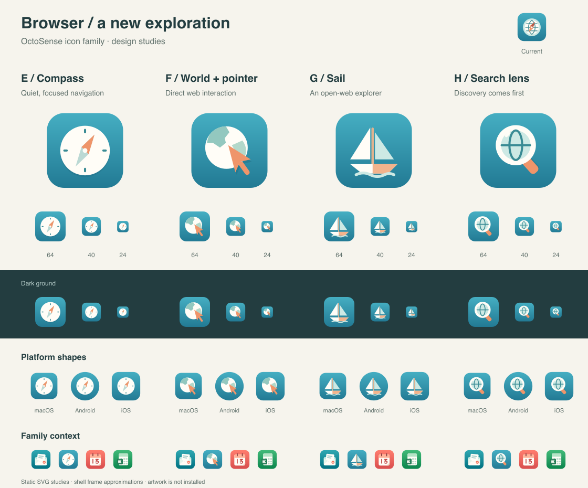

# 浏览器图标备选方案 — 第二组

[English](README.md) | 简体中文

这组方案围绕导航与发现展开，沿用浏览器的青色背景，以及 OctoSense 的象牙白、薄荷色和杏色材质。



| 方案 | 设计方向 | 取舍 |
| --- | --- | --- |
| [E — 指南针](e-compass.svg) | 简洁象牙白表盘与双色指针 | 推荐作为当前图标的简化演进；导航含义熟悉 |
| [F — 地球与指针](f-world-pointer.svg) | 大块陆地组成的地球与杏色鼠标指针 | 网页交互含义最明确；指针增加了一个辅助物体 |
| [G — 帆船](g-sail.svg) | 象牙白帆船、薄荷色帆与杏色船身 | 探索主题鲜明；浏览器含义需要通过使用建立关联 |
| [H — 搜索镜](h-search-lens.svg) | 放大镜中的地球 | 网页搜索含义清晰；也可能让人联想到独立搜索应用 |

原有 A–D 方案保留在[第一组](../README.zh-CN.md)。这些 SVG 原稿使用正方形满幅背景，不预置平台圆角或外部阴影，前景位于中央 66% 安全区域。对比图展示 64/40/24 像素尺寸、深浅背景、近似平台外框，以及已批准的家族图标。此次未更改正式应用中的图标。

在仓库根目录重新生成：

```sh
python3 docs/design/icon-family/browser-alternatives/set-2/build.py
```

此命令已运行。它复用第一组的预览脚本，依赖 librsvg 和 Pillow，检查 XML 解析及前景像素边界，并生成 SVG 原稿和对比图。对比图已进行目视检查。这些方案的生产渲染和设备表现均**未经验证**。
